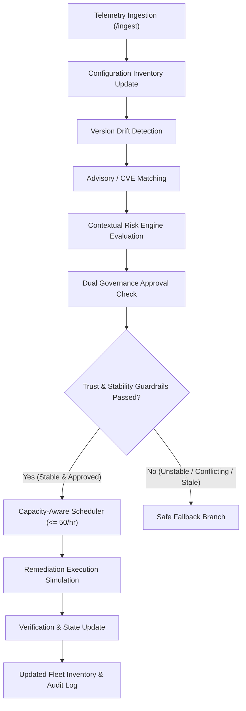
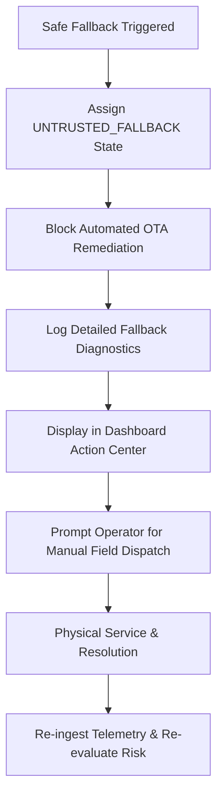

# Technical Documentation & System Architecture Specification

> **CRITICAL OPERATIONAL DISCLAIMER:**  
> **Operational device support only — this system does not provide medical advice or clinical recommendations.**

---

## 1. System Overview & Problem Statement

Home-care healthcare providers increasingly lend remote monitoring devices (pulse oximeters, ECG monitors, home telemetry gateways) to patients. A pervasive operational challenge in this domain is **version drift and uncoordinated firmware management**:

* Software and firmware versions are not tracked consistently across the dispersed fleet.
* Operators struggle to identify vulnerable devices affected by newly published CVEs.
* Network exposures vary widely (e.g., Cellular Direct vs Home Wi-Fi vs Hospital Subnets).
* Maintenance approvals between IT Engineering and Clinical Operations often conflict.
* Attempting remote updates over unstable links causes device bricking, risking patient telemetry loss.
* Simultaneous mass updates risk exceeding cellular bandwidth caps.

This system provides an end-to-end, production-grade operational framework to solve these challenges with mathematical risk contextualization, deterministic safety fallbacks, dual governance validation, and capacity-aware batch scheduling.

---

## 2. Field Workflow Map

### Primary Operational Remediation Path

### Safe Fallback Branch

---

## 3. Formal Mathematical Risk Engine Formulation

To ensure complete objectivity, explainability, and deterministic reproducibility, device risk is computed using the following formal mathematical formulation:

### 3.1 Base Risk
$$\text{Base Risk} = \text{CVSS Base Score} \in [0.0, 10.0]$$
*Derived from the highest active security advisory matching the device model and affected firmware version. If no active CVE matches, $\text{Base Risk} = 0.0$.*

### 3.2 Network Multipliers
$$\text{Network Multiplier} = \begin{cases} 
1.2 & \text{for Cellular Direct (Directly exposed public WAN)} \\
1.0 & \text{for Home Wi-Fi NAT (Standard residential gateway)} \\
0.8 & \text{for Hospital Subnet (Managed clinical network)}
\end{cases}$$

### 3.3 Version Lag Penalty
Let $L$ be the version lag step count (major, minor, patch steps behind the latest supported firmware).
$$\text{Version Lag Penalty} = \min(2.0, L \times 0.5)$$
*If the device is on the latest supported release ($L = 0$), the penalty is $0.0$.*

### 3.4 Final Risk Score
$$\mathbf{\text{Final Risk Score}} = \min\left(10.0, (\text{CVSS Base Score} \times \text{Network Multiplier}) + \text{Version Lag Penalty}\right)$$

### 3.5 Risk Categorization
$$\text{Risk Category} = \begin{cases} 
\text{LOW} & \text{if } \text{Final Risk Score} \le 3.0 \\
\text{MEDIUM} & \text{if } 3.0 < \text{Final Risk Score} \le 6.0 \\
\text{HIGH} & \text{if } 6.0 < \text{Final Risk Score} \le 8.0 \\
\text{CRITICAL} & \text{if } 8.0 < \text{Final Risk Score} \le 10.0
\end{cases}$$

---

## 4. Safe Fallback Triggers (`UNTRUSTED_FALLBACK`)

The system enforces deterministic safety invariants. If any condition fails, the device is immediately assigned `UNTRUSTED_FALLBACK` status, blocking automated OTA updates:

1. **Condition 1 — Missing or Stale Telemetry:**  
   $$(T_{\text{current}} - T_{\text{last\_seen}}) > 48\text{ hours} \quad \lor \quad \text{version\_drift\_state} == \text{"UNKNOWN"}$$
2. **Condition 2 — Conflicting Maintenance Approvals:**  
   $$\text{IT\_Approved} \ne \text{Clinical\_Ops\_Approved}$$
3. **Condition 3 — Network Flapping & Packet Loss:**  
   $$\text{connectivity\_status} == \text{"FLAPPING"} \quad \lor \quad \text{packet\_loss} > 15.0\%$$

---

## 5. Capacity-Aware Update Scheduling

* **Strict Capacity Limit:** Maximum **50 OTA updates per hourly slot**.
* **Prioritization Weight:**
  $$\text{Priority Weight} = (\text{Final Risk Score} \times 10.0) + (5.0 \text{ if vulnerable}) + \text{Version Lag}$$
* **Slot Allocation:** Slots are populated sequentially ($Hour_1, Hour_2, \dots$). Overflow devices automatically queue into subsequent slots. Under no circumstance does any slot exceed 50 devices.

---

## 6. Database Entity-Relationship Schema

The system uses SQLAlchemy ORM with a corresponding SQLite schema DDL (`schema.sql`):

* `devices`: Central inventory with hardware identifiers, versions, network metadata, risk scores, and fallback states.
* `advisories`: Active CVE vulnerabilities, affected/fixed versions, and CVSS scores.
* `maintenance_approvals`: Dual IT and Clinical Operations governance tracking.
* `telemetry`: Historical and live telemetry events (versions, network status, packet loss).
* `update_schedules`: Capacity slot allocations and queue prioritization.
* `remediations`: Durable audit log of all simulated remediation attempts and fallback blocks.

---

## 7. REST API Endpoints Specification

| Method | Endpoint | Description |
| :--- | :--- | :--- |
| `GET` | `/health` | Health check endpoint returning operational disclaimer. |
| `POST` | `/ingest` | Ingest real-time device telemetry and recalculate drift/risk. |
| `GET` | `/inventory` | Query full fleet inventory with risk breakdown and filters. |
| `POST` | `/approvals` | Update IT and Clinical maintenance approval status. |
| `POST` | `/schedule` | Generate capacity-constrained hourly update batches (max 50/hr). |
| `GET` | `/capacity` | Query hourly slot utilization and queue depth. |
| `POST` | `/remediate/{device_id}` | Execute simulated remediation workflow with safety checks. |
| `GET` | `/advisories` | List active CVE security advisories. |
| `POST` | `/telemetry/mock` | Post mock telemetry into ingestion pipeline. |
| `GET` | `/telemetry/{device_id}` | Retrieve historical telemetry records for a device. |
| `POST` | `/telemetry/simulate-flapping/{device_id}` | Simulate network instability / link flapping. |
| `POST` | `/telemetry/simulate-missing/{device_id}` | Simulate stale telemetry (>48 hours offline). |

---

## 8. Prototype Limitations & Production Roadmap

### 8.1 Realistic Prototype Scope
* **Simulated OTA Execution:** Firmware updates and network flapping states are simulated deterministically; no physical embedded hardware is reflashed in this prototype.
* **Database Engine:** Uses SQLite for local zero-dependency testing and rapid evaluation. Production systems should use PostgreSQL with read replicas.
* **CVE Feeds:** Synthetic CVE advisory dataset modeled after real-world medical IoT vulnerability patterns.

### 8.2 Production Requirements for Real-World Deployment
* **Mutual TLS (mTLS) & Device Certificates:** Cryptographic hardware attestation (e.g. TPM / Secure Element) for all telemetry payloads.
* **Cryptographic Firmware Signing:** Dual-signature verification (Vendor + Health System) before bootloader commits firmware.
* **Role-Based Access Control (RBAC):** SSO / SAML integration with distinct IT Admin and Clinical Director permission levels.
* **Regulatory Compliance:** FDA Cyber Device Guidance (PMA/510k) and HIPAA audit logging compliance.
